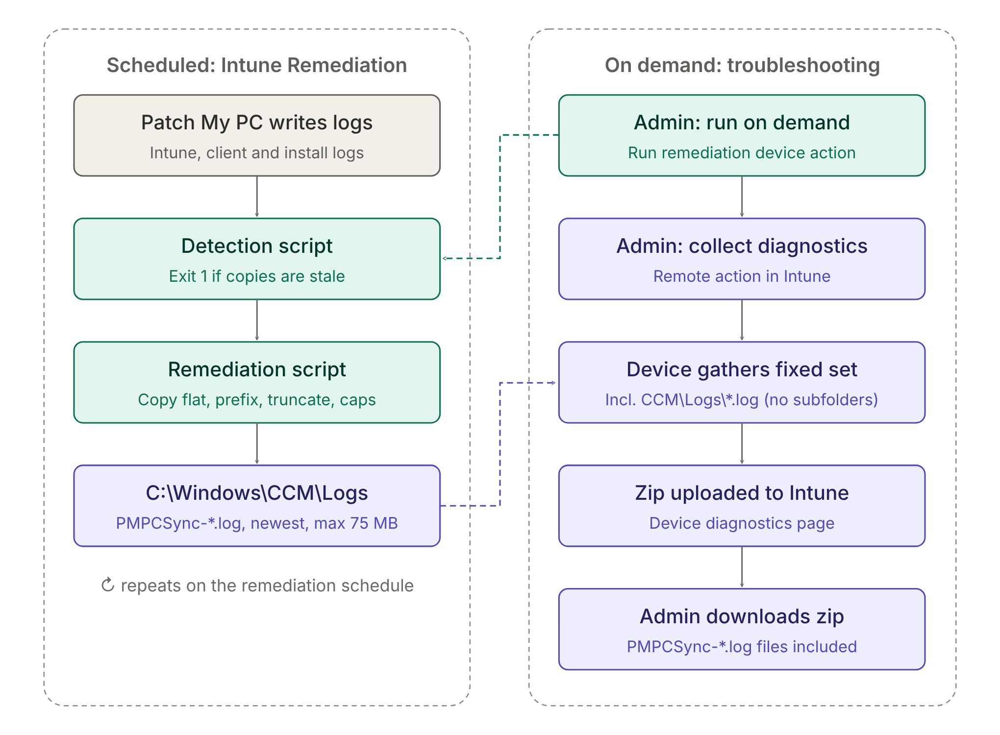

# Remediate-PatchMyPCLogSync
Move in this case Patch My PC logs over to the IME folder which is gathered via Microsoft Intune

An Intune Remediation **remediation script** that mirrors Patch My PC client logs into the Intune Management Extension (IME) `Logs` folder. Because that folder is included when you trigger the **Collect diagnostics** remote action in Intune, the Patch My PC logs end up in the diagnostics zip without any extra effort.

## Credits

The idea for this script came from **Merlijn Van Waeyenberghe**, who suggested placing the Patch My PC logs under the IME log location that is gathered by the Intune **Collect diagnostics** remote action.

## How it works



## What it does

- Copies new or changed logs to `C:\ProgramData\Microsoft\IntuneManagementExtension\Logs\PatchMyPC`, keeping the source folder structure under a subfolder per source.
- Opens source files with shared read access, so logs that are currently being written to can still be copied.
- Only mirrors logs written in the last `$MaxAgeDays` days.
- Truncates large logs to the last `$MaxFileSizeMB` MB (the newest entries are kept) and adds a marker line at the top of the truncated copy.
- Selects files newest-first so the mirror stays within `$MaxTotalSizeMB`, which keeps the diagnostics zip lean.
- Removes mirrored copies older than `$RetentionDays` days, enforces the total size cap (oldest removed first) and cleans up empty subfolders.
- Sets the last write time of each copy to that of the source, so a detection script can reliably compare the two.

## Source locations

| Name | Path | Files | Recurse |
|------|------|-------|---------|
| `PatchMyPCIntuneLogs` | `%ProgramData%\PatchMyPCIntuneLogs` | `*.log`, `*.lo_` | Yes |
| `PatchMyPCClient` | `%ProgramData%\PatchMyPC\Logs` | `*.log`, `*.lo_` | Yes |
| `PatchMyPCRoot` | `%ProgramData%\PatchMyPC` | `*.log` | No |
| `CCMLogs` | `%WinDir%\CCM\Logs` | `PatchMyPC*.log` | No |

If you changed the Patch My PC **Manage Installation Logging** folder, add it to the `$Sources` list (an example is included, commented out, in the script).

## Configuration

Settings are in the `CONFIG` block at the top of [Remediate-PatchMyPCLogSync.ps1](Remediate-PatchMyPCLogSync.ps1).

| Variable | Default | Description |
|----------|---------|-------------|
| `$DestRoot` | `%ProgramData%\Microsoft\IntuneManagementExtension\Logs\PatchMyPC` | Mirror destination inside the IME log folder |
| `$MaxAgeDays` | `14` | Only mirror source logs written in the last N days |
| `$MaxFileSizeMB` | `10` | Per-file cap; larger logs keep only the last N MB |
| `$MaxTotalSizeMB` | `75` | Size cap for the whole mirror folder |
| `$Sources` | see above | Folders, include patterns and recursion to mirror |
| `$RetentionDays` | `30` | Remove mirrored copies older than N days (remediation only) |

## Deployment

Create a script package under **Devices > Scripts and remediations** in the Intune admin center:

- **Remediation script:** `Remediate-PatchMyPCLogSync.ps1`
- **Detection script:** a matching detection script that uses the same selection and the same `CONFIG` block. It is not included in this repository. Keep the `CONFIG` block identical in both scripts.
- **Run this script using the logged-on credentials:** No (runs as SYSTEM)
- **Run script in 64-bit PowerShell:** Yes
- **Schedule:** for example daily

## Output and exit codes

The script writes a one-line summary, for example:

```
Copied: 12 | Failed: 0 | Removed: 3 | Mirror: C:\ProgramData\Microsoft\IntuneManagementExtension\Logs\PatchMyPC
```

| Exit code | Meaning |
|-----------|---------|
| `0` | Success |
| `1` | One or more files failed to copy, or the script hit an error |

## Collecting the logs

In the Intune admin center, select the device and run **Collect diagnostics**. The Patch My PC logs are included in the diagnostics zip under the IME logs, in the `PatchMyPC` folder.

## License

[MIT](LICENSE)
