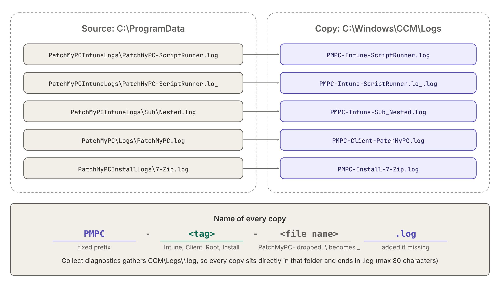

# Remediate-PatchMyPCLogSync
Copy Patch My PC logs to a folder that is gathered by the Microsoft Intune Collect diagnostics remote action

An Intune Remediation (detection + remediation script pair) that mirrors Patch My PC client logs into `C:\Windows\CCM\Logs`. Because the `*.log` files in that folder are included when you trigger the **Collect diagnostics** remote action in Intune, the Patch My PC logs end up in the diagnostics zip without any extra effort.

| Script | Role |
|--------|------|
| [Detect-PatchMyPCLogSync.ps1](Detect-PatchMyPCLogSync.ps1) | **Detection:** checks whether the mirrored copies are in sync with the source logs. Exit `1` triggers the remediation. |
| [Remediate-PatchMyPCLogSync.ps1](Remediate-PatchMyPCLogSync.ps1) | **Remediation:** copies, truncates and cleans up the mirrored logs. |

## Credits

The idea for this script came from **Merlijn Van Waeyenberghe**, who suggested placing the Patch My PC logs in a log location that is gathered by the Intune **Collect diagnostics** remote action.

## Why C:\Windows\CCM\Logs

Collect diagnostics gathers a fixed list of files and folders, including `%WinDir%\CCM\Logs\*.log`. That wildcard only matches `.log` files **directly in** the folder: no subfolders and no other extensions. The scripts therefore copy every log **flat** into `C:\Windows\CCM\Logs`, with a prefix that tells you which folder it came from (see [File naming](#file-naming)).

## How it works


## What it does

**Detection** (`Detect-PatchMyPCLogSync.ps1`)

- Builds the list of source logs that should be mirrored, using the same selection as the remediation (age, per-file size and total size cap).
- Compares the last write time of each mirrored copy with its source. A missing copy or a different timestamp counts as out of sync.
- Exits `0` when everything is in sync or when no Patch My PC logs are found, and `1` when files need mirroring. Because both scripts apply the same total size cap, files dropped by the cap never count as out of sync.
- Makes no changes on the device.

**Remediation** (`Remediate-PatchMyPCLogSync.ps1`)

- Copies new or changed logs flat to `C:\Windows\CCM\Logs`, with short names such as `PMPC-Intune-ScriptRunner.log` (see [File naming](#file-naming)). The folder is created when it does not exist.
- Opens source files with shared read access, so logs that are currently being written to can still be copied.
- Only mirrors logs written in the last `$MaxAgeDays` days.
- Truncates large logs to the last `$MaxFileSizeMB` MB (the newest entries are kept). See [Truncation](#truncation).
- Selects files newest-first so the mirror stays within `$MaxTotalSizeMB`, which keeps the diagnostics zip lean.
- Removes mirrored copies older than `$RetentionDays` days and enforces the total size cap. Only files named `PMPC-*.log` are ever removed; the ConfigMgr client logs and other files in `C:\Windows\CCM\Logs` are never touched. When the cap is exceeded, copies that are no longer selected (for example rotated or deleted source logs) are removed first, oldest first. Selected copies are only removed as a last resort, so the remediation does not remove files that the detection then reports as missing.
- Sets the last write time of each copy to that of the source, so a detection script can reliably compare the two.

## File naming



Every copy is stored as `<FilePrefix>-<Name>-<relative path>.log`. Names are kept as short as possible while still showing where the log came from:

- `<FilePrefix>` is `PMPC` by default. It marks the file as a copy made by these scripts, and the remediation only ever removes files with this prefix.
- `<Name>` is the short tag of the source in `$Sources` (`Intune`, `Client`, `Root` or `Install`, see [Source locations](#source-locations)), so you can tell which folder the log came from.
- `<relative path>` is the path below that source folder, with `\` replaced by `_`. A leading `PatchMyPC-` is dropped, because the prefix already says so.
- Files that do not end in `.log` (such as rotated `.lo_` logs) get `.log` appended, because Collect diagnostics only gathers `*.log` from this folder.
- Names longer than `$MaxNameLength` (80) characters are cut off and end in `~` plus a short code made from the source path, so they stay unique. This keeps the full path short enough when the diagnostics zip is extracted to a deep folder.
- If two files would end up with the same name, the second keeps its full name or gets the short code.

| Source file | Copy in `C:\Windows\CCM\Logs` |
|-------------|-----------------------------------|
| `C:\ProgramData\PatchMyPCIntuneLogs\PatchMyPC-ScriptRunner.log` | `PMPC-Intune-ScriptRunner.log` |
| `C:\ProgramData\PatchMyPCIntuneLogs\PatchMyPC-ScriptRunner.lo_` | `PMPC-Intune-ScriptRunner.lo_.log` |
| `C:\ProgramData\PatchMyPCIntuneLogs\Sub\Nested.log` | `PMPC-Intune-Sub_Nested.log` |
| `C:\ProgramData\PatchMyPC\Logs\PatchMyPC.log` | `PMPC-Client-PatchMyPC.log` |
| `C:\ProgramData\PatchMyPCInstallLogs\7-Zip.log` | `PMPC-Install-7-Zip.log` |
| `C:\ProgramData\PatchMyPCInstallLogs\Microsoft Visual C++ 2015-2022 Redistributable (x64) 14.40.33816_x64_MSI_Install.log` | `PMPC-Install-Microsoft Visual C++ 2015-2022 Redistributable (x64) 14.~0445a7.log` |

The truncation marker (below) also names the full source path.

## Truncation

Logs larger than `$MaxFileSizeMB` are not copied in full. The remediation keeps only the end of the log, because the newest entries are usually the ones you need for troubleshooting:

- The copy starts with a marker line, so it is clear the file was truncated:
  `<<< Truncated by PatchMyPC log sync: last 10 MB of C:\ProgramData\PatchMyPC\Logs\PatchMyPC.log >>>`
- The marker counts towards `$MaxFileSizeMB`, so a truncated copy is never larger than the cap.
- The kept part starts at the first full line, so the copy does not begin with half a log entry.
- The encoding of the source is kept: for UTF-16 logs (such as MSI installation logs) and UTF-8 logs with a BOM, the BOM and marker are written in the same encoding.
- The copy contains the log as it was when it was selected, even if it is still being written to. This keeps the content in line with the timestamp of the copy, and a growing log cannot push the mirror over the size caps.

The source log is never changed; only the mirrored copy is truncated. A small log is copied as is.

## Source locations

| Name | Path | Files | Recurse |
|------|------|-------|---------|
| `Intune` | `%ProgramData%\PatchMyPCIntuneLogs` | `*.log`, `*.lo_` | Yes |
| `Client` | `%ProgramData%\PatchMyPC\Logs` | `*.log`, `*.lo_` | Yes |
| `Root` | `%ProgramData%\PatchMyPC` | `*.log` | No |
| `Install` | `%ProgramData%\PatchMyPCInstallLogs` | `*.log` | Yes |

The `Name` is the tag in the file name of each copy, so keep it short and unique when you add a source.

`Install` holds the installation logs (for example MSI logs) written by Patch My PC when **Manage Installation Logging** is enabled. If you changed that folder, update the `Install` path in the `$Sources` list of both scripts, or add your folder as an extra entry (an example is included, commented out, in the scripts).

The `PatchMyPC*.log` files that the ConfigMgr client writes to `C:\Windows\CCM\Logs` are not mirrored: they are already in the collected folder.

## Configuration

Settings are in the `CONFIG` block at the top of [Remediate-PatchMyPCLogSync.ps1](Remediate-PatchMyPCLogSync.ps1) and [Detect-PatchMyPCLogSync.ps1](Detect-PatchMyPCLogSync.ps1). **Keep the `CONFIG` block identical in both scripts**, otherwise detection and remediation disagree about what is in sync. `$RetentionDays` exists only in the remediation script.

| Variable | Default | Description |
|----------|---------|-------------|
| `$DestRoot` | `%WinDir%\CCM\Logs` | Destination; the copies are stored flat, because Collect diagnostics does not gather subfolders |
| `$FilePrefix` | `PMPC` | Prefix of every copy; cleanup only touches files with this prefix |
| `$MaxNameLength` | `80` | Longer file names are cut off and get a short code, so they stay unique |
| `$MaxAgeDays` | `14` | Only mirror source logs written in the last N days |
| `$MaxFileSizeMB` | `10` | Per-file cap; larger logs keep only the last N MB |
| `$MaxTotalSizeMB` | `75` | Size cap for all mirrored copies together |
| `$Sources` | see above | Folders, include patterns and recursion to mirror |
| `$RetentionDays` | `30` | Remove mirrored copies older than N days (remediation only) |

## Deployment

Create a script package under **Devices > Scripts and remediations** in the Intune admin center:

- **Detection script:** `Detect-PatchMyPCLogSync.ps1`
- **Remediation script:** `Remediate-PatchMyPCLogSync.ps1`
- **Run this script using the logged-on credentials:** No (runs as SYSTEM)
- **Run script in 64-bit PowerShell:** Yes
- **Schedule:** for example daily

## Output and exit codes

Both scripts write a one-line summary that shows up in the Intune remediation report.

**Detection**

| Exit code | Output example | Meaning |
|-----------|----------------|---------|
| `0` | `In sync: 12 log file(s) mirrored to C:\Windows\CCM\Logs.` | Compliant |
| `0` | `No Patch My PC logs found on this device.` | Nothing to mirror, compliant |
| `1` | `Out of sync: 3 of 12 log file(s) need mirroring.` | Remediation runs |
| `1` | `Detection error: ...` | The script hit an error |

**Remediation**

```
Copied: 12 | Failed: 0 | Removed: 3 | Mirror: C:\Windows\CCM\Logs
```

| Exit code | Meaning |
|-----------|---------|
| `0` | Success |
| `1` | One or more files failed to copy, or the script hit an error |

## Collecting the logs

In the Intune admin center, select the device and run **Collect diagnostics**. The Patch My PC logs are included in the diagnostics zip with the other CCM logs, as the `PMPC-*.log` files.

## Pictures

The pictures are `pmpc-log-sync-flow.png` and `pmpc-log-sync-naming.png` (transparent background, so they work on light and dark pages). The `.svg` files next to them are the editable sources; they use the Inter font.

## License

[MIT](LICENSE)
